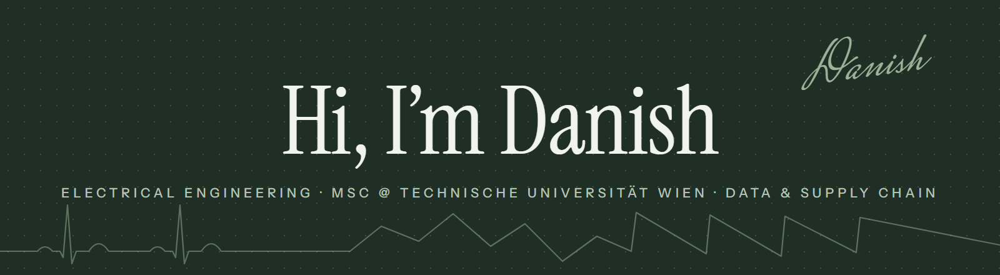
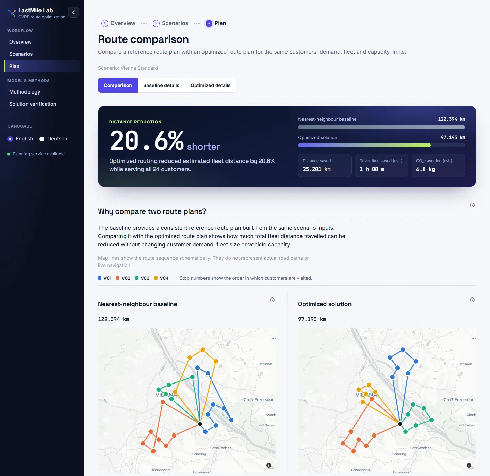
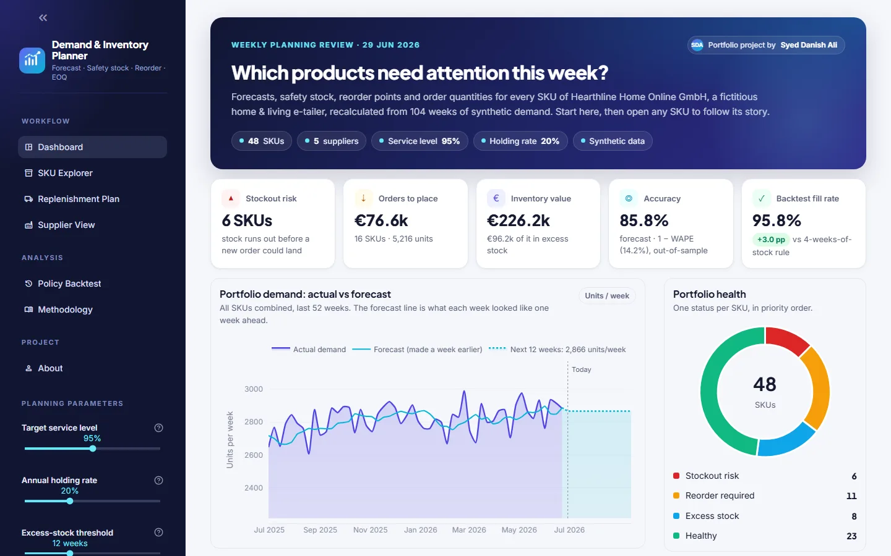

  
  
  
  

  
  
  

---

## About me

Electrical engineer, now doing my MSc in Information and Communication Engineering at **Technische Universität Wien**.
I build tools that turn messy engineering and operations problems into decisions you can check, right where **signals, data and supply chains** meet.

 &nbsp;Started on a factory floor at **Mondelēz** (LU Biscuits), tracking why production lines stopped and how to keep them running 
 &nbsp;Then product and supply chain work: dark stores and delivery zones at **Airlift**, seller logistics in five markets at **Alibaba (Daraz)** 
 &nbsp;**MS in Supply Chain and Retail Management** at LUMS, with a thesis on routing warehouse workers using MILP 
 &nbsp;I test everything against something simpler, and I label synthetic data as synthetic 
 &nbsp;English (C1) · German (A1, learning)

## What I'm working on

<table>
  <tr>
    <td width="50%" valign="top">
      <h3> ECG Noise Stress-Test Bench</h3>
      Heartbeat detectors are usually judged on clean recordings. My bench mixes real electrode, muscle and baseline noise into annotated ECG and watches five open-source detectors until they break. <b>2,820 runs over 61 hours of noisy ECG.</b> Research and teaching tool, not a medical device.
        <a href="https://github.com/syeddanishali17/BioLab-ECG">Code →</a>
    </td>
    <td width="50%" valign="top">
      <h3> MSc at Technische Universität Wien</h3>
      Information and Communication Engineering. Current courses include Introduction to Biostatistics and Modern Sensor Technologies, which feed straight into the biosignal work.
    </td>
  </tr>
  <tr>
    <td width="50%" valign="top">
      <h3> LastMile Lab</h3>
      Which van takes which order, and in what order to drive? A simple nearest-stop rule against Google OR-Tools for a made-up Vienna delivery company. In a synthetic 24-customer scenario the optimised plan is <b>20.6% shorter</b>.
        <a href="https://lastmilelab.streamlit.app/">Live app ↗</a> · <a href="https://github.com/syeddanishali17/LastMileLab2">Code →</a>
    </td>
    <td width="50%" valign="top">
      <h3> DemandPlanningLab</h3>
      Turns weekly forecasts into reorder decisions for 48 synthetic products. Built in Excel first, then in Python, and checked to match for every product. Better service in the backtest, <b>95.8% vs 92.8% fill rate</b>, at the cost of more stock.
        <a href="https://demandplanninglab.streamlit.app/">Live app ↗</a> · <a href="https://github.com/syeddanishali17/DemandPlanningLab">Code →</a>
    </td>
  </tr>
</table>

## LastMile Lab: from orders to van routes

  

 &nbsp;**Baseline first:** a deterministic, capacity-aware nearest-neighbour rule, so the optimiser has something honest to beat 
 &nbsp;**Solver behind an API:** OR-Tools runs in a FastAPI service; the Streamlit interface never solves anything itself 
 &nbsp;**Reconcilable numbers:** loads and distances are rebuilt from the returned routes and checked independently 
 &nbsp;**More than distance:** route crossings and territory overlap, because dispatchers care how a plan looks

## DemandPlanningLab: from forecast to purchase order

  

 &nbsp;**Explainable forecasts:** four simple methods scored walk-forward, so no future data leaks into past decisions 
 &nbsp;**Inventory logic:** safety stock, reorder points and EOQ rounded to the case pack 
 &nbsp;**Excel as the referee:** 69 tests check the Python engine against the workbook for every SKU 
 &nbsp;**Honest trade-off:** 71 vs 145 stockout SKU-weeks, but 76% more average inventory

## Tech stack

  

  
  
  
  
  
  
  

## More projects

<table>
  <tr>
    <td width="33%" valign="top">
      <h3> BloodTypeLab</h3>
      Agent-based simulation of ABO and RhD inheritance, starting from published Austrian blood-group shares. Synthetic population, not a forecast.
        <a href="https://bloodtypelab-edu.streamlit.app/">Live app ↗</a> · <a href="https://github.com/syeddanishali17/BloodtypeLab-edu">Code →</a>
    </td>
    <td width="33%" valign="top">
      <h3> CircularLoop Lab</h3>
      Ranks repair, reuse, refurbishment, remanufacturing and recycling for industrial components from lifecycle data, with transparent rules.
        <a href="https://github.com/syeddanishali17/circularloopLab">Code →</a>
    </td>
    <td width="33%" valign="top">
      <h3> Signal Tutor</h3>
      Interactive lessons on sensor electronics, signal conditioning and circuits: explore, name, derive, break it, check, explain it.
        <a href="https://github.com/syeddanishali17/SignalTutor">Code →</a>
    </td>
  </tr>
</table>

---

  Based in Vienna · Build it, test it, explain it.

